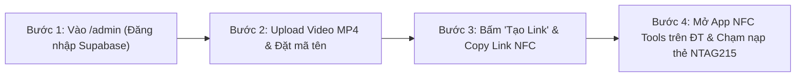

# BÁO CÁO ĐỀ XUẤT GIẢI PHÁP & XÁC NHẬN BÀN GIAO DỰ ÁN

**(NFC-Triggered WebAR Palm Video Player)**

| Thông tin | Nội dung |
| :--- | :--- |
| **Dự án** | Trải nghiệm Video Thực tế Tăng cường (AR) trên Lòng Bàn Tay kết hợp Chip NFC |
| **Tài liệu** | Báo cáo Giải pháp, Phạm vi & Tiêu chí Bàn giao (Bản chuẩn hóa triển khai) |
| **Phiên bản** | 2.0 (Toàn bộ các yêu cầu & kiến trúc kỹ thuật đã chốt chính thức) |
| **Ngày** | 09/11/2026 |
| **Công nghệ** | Node.js, JavaScript (Vite), Google MediaPipe, Supabase All-in-One Cloud |

---

## Mục lục

1. [Ý tưởng sản phẩm](#1-ý-tưởng-sản-phẩm-tổng-quan-giải-pháp)
2. [Phạm vi dự án](#2-phạm-vi-dự-án)
3. [Luồng hoạt động (User Flow)](#3-luồng-hoạt-động-user-flow)
4. [Chức năng trang quản trị `/admin`](#4-chức-năng-trang-quản-trị-admin)
5. [Thiết bị & điều kiện sử dụng hỗ trợ](#5-thiết-bị--điều-kiện-sử-dụng-hỗ-trợ)
6. [Yêu cầu đối với video đầu vào](#6-yêu-cầu-đối-với-video-đầu-vào)
7. [Lưu ý & giới hạn kỹ thuật](#7-lưu-ý--giới-hạn-kỹ-thuật)
8. [Hạ tầng & chi phí vận hành](#8-hạ-tầng--chi-phí-vận-hành)
9. [Bộ hồ sơ bàn giao](#9-bộ-hồ-sơ-bàn-giao-cuối-cùng-cho-khách-hàng)
10. [Bảo hành & hỗ trợ sau bàn giao](#10-bảo-hành--hỗ-trợ-sau-bàn-giao)
11. [Tiêu chí nghiệm thu](#11-tiêu-chí-nghiệm-thu--bàn-giao-acceptance-criteria)
12. [Bảng tổng hợp các nội dung Khách hàng đã chốt](#12-các-nội-dung-khách-hàng-đã-xác-nhận-đã-chốt)
13. [Tiến độ & chi phí](#13-tiến-độ--chi-phí)
14. [Xác nhận triển khai](#14-xác-nhận-triển-khai)

---

## 1. Ý tưởng sản phẩm (Tổng quan Giải pháp)

Hệ thống kết hợp giữa **Thẻ chip thông minh NFC (NTAG215)** và **Công nghệ Trí tuệ Nhân tạo Nhận diện Bàn tay trên trình duyệt web (WebAR Hand Tracking)**:

- Khi người dùng chạm điện thoại vào **chip NFC** (gắn trên ấn phẩm, quà tặng, thiệp mời sự kiện...), điện thoại sẽ tự động mở liên kết WebAR tương ứng với thẻ đó mà **hoàn toàn không cần cài đặt thêm ứng dụng**.
- Trình duyệt mở Camera sau của điện thoại. Khi người dùng giơ lòng bàn tay ngửa trước camera, hệ thống AI nhận diện theo thời gian thực và **hiển thị khung phát video MP4 (tỷ lệ 16:9 to rõ, có âm thanh) nằm ngay trong lòng bàn tay**, bám sát theo cử động tay. Giao diện camera hoàn toàn sạch sẽ (Clean UI), không có nút bấm thừa.

---

## 2. Phạm vi dự án

### 2.1. Trong phạm vi (In scope)

| STT | Hạng mục |
| :-: | :--- |
| 1 | Trang WebAR cho người dùng cuối: mở camera sau, nhận diện lòng bàn tay ngửa, phát video MP4 (hình + tiếng) trong lòng bàn tay theo chuẩn Clean UI. |
| 2 | Trang quản trị `/admin`: xác thực 02 tài khoản, tải video lên Supabase Storage, tạo link NFC, mã QR dự phòng, bảng theo dõi thống kê số lượt quét thực tế (`view_count`). |
| 3 | Tự động phát hiện In-App Browser (Zalo, Facebook, TikTok) và hiển thị chỉ dẫn mở bằng Safari/Chrome. |
| 4 | Triển khai hệ thống lên Internet với chứng chỉ bảo mật HTTPS (Vercel). |
| 5 | Bàn giao tài khoản hạ tầng Supabase, mã nguồn và tài liệu hướng dẫn vận hành. |
| 6 | Kiểm thử trên thiết bị đã thống nhất (Mục 5) và nghiệm thu theo Mục 11. |

### 2.2. Ngoài phạm vi (Out of scope)

| STT | Hạng mục không bao gồm |
| :-: | :--- |
| 1 | Sản xuất, dựng hoặc biên tập nội dung video (Khách hàng cung cấp file MP4). |
| 2 | Cung cấp, in ấn hoặc nạp sẵn thẻ NFC (Khách hàng tự nạp theo hướng dẫn đơn giản ở Mục 3.2). |
| 3 | Ứng dụng di động cài đặt (App Store / Google Play); hệ thống chạy 100% trên nền tảng WebAR. |
| 4 | Hỗ trợ các trình duyệt hoặc thiết bị đời cũ ngoài danh sách ở Mục 5. |

---

## 3. Luồng hoạt động (User Flow)

### 3.1. Luồng Người dùng cuối (Người trải nghiệm quét thẻ) — Tối giản & Mượt mà

1. **Chạm thẻ NFC:** Người dùng chạm điện thoại vào thẻ NFC NTAG215 $\rightarrow$ Màn hình hiện thông báo mở ngay trang web.
2. **Kích hoạt:** Bấm nút **"Chạm để Bắt đầu"** (trên màn hình Splash có hiển thị Logo Khách hàng) $\rightarrow$ Camera sau mở toàn màn hình (giao diện hoàn toàn sạch sẽ, không có nút bấm rườm rà).
3. **Giơ lòng bàn tay:** Ngửa lòng bàn tay trước camera $\rightarrow$ **Khung video MP4 16:9 tự động hiện ra và phát ngay trong lòng bàn tay** (có hình và tiếng). Bàn tay di chuyển đến đâu, video bám theo đến đó. Hệ thống đồng thời ghi nhận `+1` lượt quét hợp lệ vào hệ thống thống kê.
4. **Hạ tay xuống:** Video tự động ẩn và tạm dừng. Đưa tay vào lại $\rightarrow$ Video phát tiếp.
5. **Video chạy hết:** Tự động phát lặp lại tức thì (**Seamless Loop**) khi bàn tay vẫn giữ trước camera.

### 3.2. Luồng Khách hàng sử dụng (Chi tiết Quy trình Vận hành & Nạp thẻ)

#### Chi tiết từng bước thực hiện:
- **Bước 1 — Đăng nhập Trang Quản trị:** Mở `https://<ten-mien-cua-ban>/admin` và đăng nhập 1 trong 2 tài khoản Admin.
- **Bước 2 — Tải Video lên:** Bấm **"Tải Video lên (Upload)"**, chọn file `.mp4` (chuẩn 16:9, dung lượng $< 8\text{MB} - 10\text{MB}$). Điền mã gợi nhớ (ví dụ: `vip-guest-01`).
- **Bước 3 — Lấy đường Link NFC:** Bấm **"Tạo Link"** $\rightarrow$ Hệ thống lưu vào Supabase và sinh ra đường dẫn (ví dụ: `https://ten-mien/?v=vip-guest-01`) kèm mã QR. Bấm **"Copy Link"**.
- **Bước 4 — Nạp Link vào Thẻ NFC bằng điện thoại:** Mở app miễn phí **NFC Tools**, chọn **Write** $\rightarrow$ **Add a record** $\rightarrow$ **URL / URI** $\rightarrow$ Dán link $\rightarrow$ Bấm **Write** và chạm thẻ NFC trong 1 giây là xong.

### 3.3. Xử lý các tình huống đặc biệt

| Tình huống | Cách hệ thống xử lý |
| :--- | :--- |
| **Mở link từ Zalo, Facebook, TikTok...** | Hệ thống phát hiện ngay và hiện Modal hướng dẫn: *"Bấm (...) ở góc trên và chọn 'Mở bằng trình duyệt Safari/Chrome'"*. |
| **Người dùng từ chối quyền camera** | Hiện thông báo ngắn hướng dẫn cách bật lại quyền camera trong cài đặt trình duyệt. |
| **Người dùng úp mu bàn tay** | Hệ thống nhận biết không phải lòng bàn tay ngửa $\rightarrow$ Không hiển thị video để đảm bảo tính chuẩn xác. |
| **Mạng chập chờn / Video tải lỗi** | Hiện thông báo lỗi thân thiện và nút thử lại. |
| **Mã video không tồn tại** | Tự động phát video mặc định (Default Demo Video). |

---

## 4. Chức năng trang quản trị `/admin`

| STT | Chức năng | Mô tả chi tiết |
| :-: | :--- | :--- |
| 1 | **Đăng nhập quản trị** | Bảo mật qua Supabase Auth (cấp sẵn 02 tài khoản quản trị). |
| 2 | **Tải video lên & Tạo mã bảo mật** | Upload file `.mp4` ($\le 20\text{MB}$) vào Supabase Storage bucket `videos`. Tự động sinh mã slug từ tên gợi nhớ kèm **hậu tố 4 ký tự ngẫu nhiên** chống dò link. |
| 3 | **Tạo link & Tải ảnh QR Offline** | Tự động sinh link WebAR, vẽ mã QR ngay trên trình duyệt kèm nút Copy Link và **Tải Ảnh QR (.PNG)**. |
| 4 | **Danh sách thẻ & Bật/Tắt nhanh** | Tìm kiếm thẻ, xem thống kê KPI tổng quan và bấm bật/tắt trạng thái kích hoạt (`Hoạt động` / `Tạm ẩn`). |
| 5 | **Đổi video giữ nguyên link** | Cho phép thay file video mới mà **giữ nguyên mã link NFC**, tự động dọn dẹp file cũ trên Storage và **đặt lại lượt quét về 0** (kèm thông báo Toast). |
| 6 | **Xóa thẻ (An toàn)** | Có hộp thoại xác nhận và dọn dẹp file trên Storage; khóa bảo vệ không cho xóa thẻ mẫu `demo` mặc định. |
| 7 | **Thống kê lượt quét (`view_count`)** | Hiển thị số lượt xem thực tế của từng thẻ, ghi nhận an toàn qua Supabase RPC khi người dùng ngửa tay xem video. |

---

## 5. Thiết bị & điều kiện sử dụng hỗ trợ

### 5.1. Thiết bị & trình duyệt hỗ trợ
- **Apple iOS:** iPhone Xs/Xr trở lên, chạy **iOS 15+** trên trình duyệt **Safari**.
- **Android:** Điện thoại có hỗ trợ NFC, RAM $\ge 3\text{GB}$, chạy trình duyệt **Google Chrome** phiên bản mới.
- *Thiết bị không có NFC:* Vẫn quét và trải nghiệm bình thường qua mã QR dự phòng.

### 5.2. Điều kiện môi trường khuyến nghị
- Ánh sáng tự nhiên hoặc ánh sáng phòng sự kiện rõ ràng, không ngược sáng gay gắt.
- Khoảng cách đưa bàn tay: Cách camera sau khoảng $25\text{cm} - 45\text{cm}$.

---

## 6. Yêu cầu đối với video đầu vào

| Yếu tố | Tiêu chuẩn kỹ thuật đã chốt |
| :--- | :--- |
| **Định dạng** | `.mp4` (chuẩn nén H.264, âm thanh AAC). |
| **Tỷ lệ khung hình** | **Ngang (16:9)** — hiển thị to rõ, tràn nhẹ hai mép ngón cái và ngón út trên lòng bàn tay. |
| **Dung lượng** | Tối ưu dưới **8MB – 10MB** để tải tức thì qua mạng 4G sự kiện. |
| **Độ dài** | Tối đa **60 giây** (tự động phát lặp lại liên tục `loop = true`). |

---

## 7. Hạ tầng & chi phí vận hành

Dự án được tối ưu hóa kiến trúc để **hoàn toàn không phát sinh chi phí hàng tháng** ở quy mô sự kiện hiện tại:

| Thành phần | Dịch vụ sử dụng | Hạn mức gói Miễn Phí (Free Tier) | Chi phí hàng tháng |
| :--- | :--- | :--- | :-: |
| **Web Hosting** | **Vercel** | Băng thông 100GB/tháng, HTTPS tự động | **0 VNĐ** |
| **Database & Auth** | **Supabase** | 500MB Database, 50.000 Active Users | **0 VNĐ** |
| **Lưu trữ Video (Storage)** | **Supabase Storage** | 1GB lưu trữ (chứa được ~100 video 10MB) | **0 VNĐ** |
| **Tên miền (Tùy chọn)** | Khách hàng tự trang bị nếu muốn dùng tên miền riêng | Theo biểu phí nhà mạng (~100k - 250k/năm) |

---

## 8. Tiêu chí nghiệm thu & bàn giao (Acceptance Criteria)

| STT | Tiêu chí nghiệm thu | Trạng thái yêu cầu |
| :-: | :--- | :---: |
| **TC-01** | **Chạm NFC mở web:** Chạm điện thoại vào thẻ NTAG215 đã nạp, điện thoại tự mở đúng đường link WebAR kèm tham số video. | Bắt buộc đạt |
| **TC-02** | **Trải nghiệm trên lòng bàn tay:** Nhấn "Bắt đầu", ngửa lòng bàn tay trước camera sau $\rightarrow$ Video 16:9 xuất hiện bám sát lòng bàn tay, phát đồng thời cả hình ảnh và âm thanh. | Bắt buộc đạt |
| **TC-03** | **Độ mượt & Chuyển động:** Khung video bám mượt (tối thiểu 24 FPS trên máy test); hạ tay video tự dừng, đưa tay lên video phát tiếp; hết video phát lặp lại tức thì. | Bắt buộc đạt |
| **TC-04** | **Clean UI:** Màn hình camera hoàn toàn sạch sẽ, không có bất kỳ nút bấm thừa nào. | Bắt buộc đạt |
| **TC-05** | **Quản trị `/admin`:** Đăng nhập thành công, tải video lên Supabase Storage, tạo link NFC, xem được thống kê số lượt quét tăng khi xem video. | Bắt buộc đạt |
| **TC-06** | **Chỉ dẫn In-App Browser:** Mở trong Zalo/Facebook hiển thị thông báo hướng dẫn mở bằng Safari/Chrome. | Bắt buộc đạt |

---

## 9. Bảng tổng hợp các nội dung Khách hàng đã chốt (Scope Freeze)

| STT | Nội dung | Thống nhất chính thức |
| :-: | :--- | :--- |
| 1 | **Công nghệ phát triển** | **Node.js + JavaScript (Vite + Vanilla JS)** để đạt tốc độ tối đa và tối ưu hiệu năng AR. |
| 2 | **Hạ tầng Cloud** | **Trọn gói trên Supabase** (Database, Auth, Storage) + Vercel Hosting. |
| 3 | **Giao diện Camera** | **Clean UI 100% (Tuyệt đối không có nút bấm thừa trên camera)**. |
| 4 | **Tỷ lệ khung hình video** | **Ngang (16:9)**, cho phép tràn nhẹ qua ngón cái và ngón út để video to rõ. |
| 5 | **Độ dài video** | **Tối đa 60 giây**, nén dưới 8MB–10MB. |
| 6 | **Cơ chế lặp** | **Seamless Loop (Chạy nối tiếp tức thì)** khi còn giữ bàn tay. |
| 7 | **Quy tắc đếm lượt quét** | **Engagement-based** (Chỉ đếm khi ngửa lòng bàn tay và video bắt đầu phát). |
| 8 | **Điều kiện nhận diện tay** | **Chỉ nhận lòng bàn tay khi ngửa**; úp mu bàn tay sẽ ẩn video. |
| 9 | **Xử lý Zalo / Messenger** | Tự động phát hiện và hiện màn hình chỉ dẫn mở Safari/Chrome. |
| 10 | **Tài khoản Quản trị** | Bàn giao **02 tài khoản Quản trị Admin**. |
| 11 | **Loại thẻ chip NFC** | **NTAG215** (Dung lượng 504 bytes). |
| 12 | **Logo thương hiệu** | Hiển thị Logo khách hàng trên màn hình "Bắt đầu" và màn hình chờ. |
| 13 | **Thời gian bảo hành** | **01 tháng** bảo hành sửa lỗi kỹ thuật kể từ ngày nghiệm thu. |
| 14 | **Thiết bị kiểm thử chuẩn** | 01 iPhone (iOS 15+) + 01 Android (RAM $\ge 3\text{GB}$). |

---

## 10. Xác nhận triển khai

> **XÁC NHẬN CHÍNH THỨC TRIỂN KHAI**
>
> Hai bên xác nhận đóng băng phạm vi (Scope Freeze) theo các nội dung đã thống nhất ở Mục 9 để đội ngũ kỹ thuật tiến hành xây dựng hệ thống theo đúng tiến độ.
