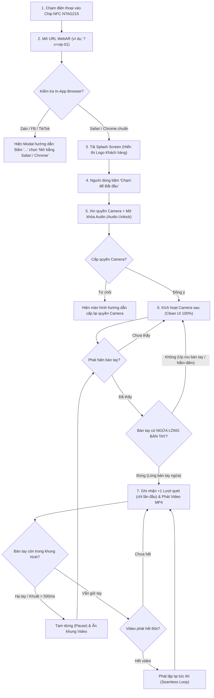

# PRODUCT REQUIREMENTS DOCUMENT (PRD)
## Dự án: NFC-Triggered WebAR Palm Video Player (Quét NFC - Hiển thị Video trên Lòng Bàn Tay)

- **Phiên bản:** 2.0.0 (Production-Ready Architecture)
- **Ngày cập nhật:** 09/11/2026
- **Trạng thái:** Đặc tả Chi tiết Đã Chốt (Signed-off & Ready for Implementation)
- **Thư mục dự án:** `C:\Software_Engineering\MINE_PRODUCTS\NFCchip`
- **Công nghệ cốt lõi:** Node.js (Runtime/Tooling), JavaScript (Vite + Vanilla JS), HTML5 Canvas/WebGL, Google MediaPipe Tasks Vision, Supabase (PostgreSQL, Auth, Storage, Edge RPC).

---

## 1. Tổng Quan Dự Án (Executive Summary)

### 1.1. Mô tả sản phẩm
Sản phẩm là giải pháp trải nghiệm tương tác vật lý - kỹ thuật số (**Phygital / O2O - Offline to Online**). Người dùng dùng điện thoại chạm vào **thẻ chip NFC (chuẩn NTAG215)** gắn trên sản phẩm/quà tặng/ấn phẩm sự kiện. Điện thoại tự động kích hoạt trình duyệt mở ứng dụng **WebAR** mà không cần tải hay cài đặt bất kỳ ứng dụng nào từ App Store hay Google Play. 

Khi người dùng giơ lòng bàn tay trước camera sau, mô hình AI thị giác máy tính (**Edge AI Hand Tracking**) nhận diện lòng bàn tay ngửa theo thời gian thực và hiển thị **khung phát video MP4 tỷ lệ 16:9 nằm gọn trong lòng bàn tay (tràn nhẹ hai mép ngón cái và ngón út)**, di chuyển và xoay mượt mà theo chuyển động thực tế.

### 1.2. Định hướng Kiến trúc Kỹ thuật (Tech Stack Decision)
Để tối ưu hóa tốc độ triển khai, tính ổn định và đạt hiệu năng tối đa trên thiết bị di động:
- **Ngôn ngữ & Nền tảng:** **Node.js (v18+)** và **JavaScript thuần (Vanilla ES Modules)** xây dựng trên nền **Vite**. Không sử dụng các framework UI nặng (như React hay Angular) để loại bỏ gánh nặng DOM virtualization, đảm bảo render mượt mà 30–60 FPS trực tiếp trên HTML5 Canvas.
- **Backend & Cloud Infrastructure (All-in-One BaaS):** Tích hợp **Supabase** (gói Free Tier đáp ứng dư sức):
  - **Supabase Database (PostgreSQL):** Quản lý danh sách mã thẻ/video, trạng thái kích hoạt và số lượt quét.
  - **Supabase Storage:** Lưu trữ trực tiếp các file video `.mp4` (hỗ trợ CDN và CORS mặc định).
  - **Supabase Auth:** Xác thực an toàn cho 02 tài khoản quản trị viên truy cập trang `/admin`.
  - **Supabase RPC (Stored Procedure):** Tự động ghi nhận và cộng lượt quét (`increment_view_count`) bảo mật, chống gian lận.
- **Trí tuệ nhân tạo (Edge Hand Tracking):** Thư viện `@mediapipe/tasks-vision` chạy hoàn toàn phía client (WASM + WebGL). Model `hand_landmarker.task` được lưu trữ nội bộ (self-hosted trong thư mục `public/models/`) để tránh độ trễ mạng quốc tế.

---

## 2. Luồng Trải Nghiệm Người Dùng (User Journey & UX States)



---

## 3. Đặc Tả Yêu Cầu Chức Năng (Functional Requirements)

### FR-01: Quản lý & Ánh xạ Video Động từ Supabase Database
- **Mô tả:** Hệ thống đọc tham số URL query `?v=slug` (ví dụ: `https://domain.com/?v=thiep-cuoi-01`).
- **Xử lý:**
  - Gọi API Supabase truy vấn bảng `cards` lấy bản ghi có `slug = 'thiep-cuoi-01'` và `is_active = true`.
  - Lấy đường dẫn file video trực tiếp từ trường `video_url` (trỏ đến Supabase Storage).
  - Nếu không truyền `?v=` hoặc mã không tồn tại, tự động chuyển về video mặc định (Default Demo Video).
- **Cấu trúc Bảng Cơ Sở Dữ Liệu `cards` trên Supabase:**
  ```sql
  create table cards (
    id uuid primary key default gen_random_uuid(),
    slug text unique not null,
    title text not null,
    video_url text not null,
    view_count integer default 0 not null,
    is_active boolean default true not null,
    created_at timestamptz default now() not null,
    updated_at timestamptz default now() not null
  );
  ```

### FR-02: Bộ Phát Hiện Trình Duyệt Nhúng (In-App Browser Detector)
- **Mô tả:** Khi quét mã QR hoặc chạm link từ trong các ứng dụng mạng xã hội (Zalo, Facebook Messenger, Instagram, TikTok...), trình duyệt Webview thường khóa quyền Camera WebRTC.
- **Hành vi hệ thống:**
  - Sử dụng Regex kiểm tra chuỗi `navigator.userAgent`:
    `/(FBAN|FBAV|Instagram|Line|Twitter|Zalo|TikTok|MicroMessenger)/i`
  - Nếu phát hiện Webview: Tạm dừng khởi tạo camera, hiển thị ngay màn hình hướng dẫn (Overlay Modal) kèm đồ họa trực quan:
    > *"Bạn đang mở liên kết trong ứng dụng [Tên App]. Vui lòng nhấn vào biểu tượng dấu ba chấm (⋮ hoặc ...) ở góc trên màn hình và chọn **'Mở bằng trình duyệt Safari / Chrome'** để kích hoạt trải nghiệm thực tế tăng cường."*

### FR-03: Nhận Diện Lòng Bàn Tay Ngửa & Tính Tọa Độ (Palm-Facing Hand Tracking)
- **Thư viện AI:** Sử dụng `@mediapipe/tasks-vision` (Class `HandLandmarker`, mode `VIDEO`, `numHands: 1`).
- **Thuật toán Kiểm tra Lòng Bàn Tay Ngửa (Palm-Facing Normal Check):**
  - Trích xuất 21 điểm mốc không gian 3D $(x, y, z)$.
  - Tạo 2 vector từ cổ tay (Mốc `0`):
    - $\vec{v}_1 = P_5 - P_0$ (từ Cổ tay đến Khớp ngón trỏ MCP)
    - $\vec{v}_2 = P_{17} - P_0$ (từ Cổ tay đến Khớp ngón út MCP)
  - Tính vector pháp tuyến bằng tích có hướng (Cross Product): $\vec{n} = \vec{v}_1 \times \vec{v}_2$.
  - Kết hợp với thuộc tính bàn tay trái hay phải (`handedness` do MediaPipe trả về):
    - Nếu thành phần $n_z < 0$ (hoặc ngược lại tùy theo tay trái/phải), xác định bàn tay đang **ngửa lòng bàn tay về phía camera**.
    - Nếu người dùng úp mu bàn tay hoặc nghiêng tay quá $70^\circ$, hệ thống từ chối vẽ video để giữ độ chuẩn xác nghiệp vụ.
- **Ánh xạ Tọa độ Màn hình (Screen-Space Projection):** Tự động bù trừ tỷ lệ co dãn và cắt viền (`object-fit: cover`) của luồng camera so với màn hình điện thoại thực tế, hỗ trợ cả chiều dọc (Portrait) và xoay ngang (Landscape).
- **Tính Tâm Lòng Bàn Tay ($P_{\text{center}}$):**
  $$P_{\text{center}} = \frac{P_0 + P_5 + P_9 + P_{17}}{4}$$
- **Thuật toán Cân Bằng Hướng Nhìn Thông Minh (Smart Horizon Auto-Leveling):**
  - Xác định tư thế bàn tay với vùng trễ **Hysteresis ($35^\circ - 55^\circ$)** cho 3 trạng thái: **Tay Đứng (`VERTICAL`)**, **Tay Ngang (`HORIZONTAL`)** và **Tay Chúc Ngược (`INVERTED`)**.
  - Dù người dùng giơ tay đứng hay đặt tay nằm ngang trên bàn, video luôn tự động bù trừ góc $90^\circ$ hoặc $180^\circ$ để **luôn hiển thị nằm ngang thuận mắt người xem**.
  - Giới hạn góc nghiêng bám tay trong khoảng **$\pm 20^\circ$ ($\pm 0.35\text{ rad}$)** giúp video giữ được độ bám 3D tự nhiên theo cổ tay mà không bị nghiêng quá đà gây khó xem.
- **Tính Kích Thước Video 16:9 Thích Ứng Tư Thế (Dynamic Pose Scaling):**
  - **Tư thế Đứng / Ngược:** $H_{\text{video}} = \|P_9 - P_0\| \times 0.95$.
  - **Tư thế Ngang:** $H_{\text{video}} = \max(\|P_{17} - P_5\| \times 1.15,\ \|P_9 - P_0\| \times 0.72)$ để khung 16:9 ôm vừa vặn lòng bàn tay nằm ngang.
  - Chiều rộng tự động tính theo chuẩn 16:9: $W_{\text{video}} = H_{\text{video}} \times \frac{16}{9}$.
- **Bộ lọc làm mượt chuyển động (EMA Filter):** Áp dụng Exponential Moving Average với hệ số $\alpha = 0.65$ cho tọa độ tâm, kích thước và góc xoay để loại bỏ hoàn toàn hiện tượng rung giật (jitter).

### FR-04: Hiển Thị Khung Video MP4 & Triết Lý Giao Diện Siêu Sạch (Pure Clean UI)
- **Thiết kế UI Camera:** Hoàn toàn **KHÔNG có bất kỳ nút bấm thừa** nào trên màn hình camera (không nút đổi camera, không nút mute/unmute, không nút xem lại). Toàn màn hình là khung hình camera sạch 100%.
- **Quy tắc Phát mượt mà (Seamless Playback):**
  - Thuộc tính thẻ video: `playsinline webkit-playsinline crossorigin="anonymous"`.
  - Tự động gọi `video.play()` (kèm âm thanh) khi phát hiện lòng bàn tay ngửa hợp lệ.
  - Tự động `video.pause()` sau 500ms nếu bàn tay rời khỏi khung hình. Khi đưa tay trở lại, video phát tiếp từ vị trí cũ.
  - Khi video phát hết thời lượng ($\le 60\text{s}$), hệ thống tự động phát lặp lại tức thì (**Seamless Loop**, `loop = true`), không có màn hình đen hay fade out.

### FR-05: Ghi Nhận Lượt Quét Chuẩn Nghiệp Vụ (Engagement-Based Scan Counting)
- **Quy tắc kích hoạt:** Chỉ thực hiện `+1` lượt quét khi thỏa mãn đồng thời:
  1. Người dùng đã bấm nút *"Bắt đầu"* trên màn hình chờ.
  2. Camera đã khởi động và AI phát hiện thành công lòng bàn tay ngửa.
  3. Video MP4 bắt đầu phát giây đầu tiên.
- **Cơ chế chống spam / Reload ảo:** Mỗi phiên truy cập của trình duyệt (dựa trên `sessionStorage`) chỉ ghi nhận duy nhất 1 lần đếm. Nếu người dùng hạ tay xuống rồi giơ tay lên nhiều lần trong cùng một lần quét thẻ, hệ thống không cộng dồn lượt quét.
- **Kỹ thuật Supabase RPC:** Sử dụng Stored Procedure với bảo mật định danh để tăng view an toàn:
  ```sql
  create or replace function increment_view_count(target_slug text)
  returns void language sql security definer as $$
    update cards
    set view_count = view_count + 1, updated_at = now()
    where slug = target_slug and is_active = true;
  $$;
  ```

### FR-06: Trang Quản Trị `/admin` Dành Cho Khách Hàng Tự Vận Hành
- **Đăng nhập & Xác thực:** Xác thực qua Supabase Auth với 02 tài khoản Admin được cấp sẵn.
- **Chức năng chính trên `/admin`:**
  1. **Upload Video trực tiếp & Validation:** Kiểm tra định dạng `.mp4` và dung lượng ($\le 20\text{MB}$ tối đa, cảnh báo nếu $> 10\text{MB}$) trước khi tải lên Supabase Storage bucket `videos`.
  2. **Quản lý Định danh Bảo mật (Auto-Slug + Hậu tố ngẫu nhiên):** Tự động chuyển đổi tên gợi nhớ sang slug không dấu và gắn kèm hậu tố 4 ký tự ngẫu nhiên (vd: `qua-tang-x8k2`) để chống dò link.
  3. **Tạo Link NFC & Mã QR Offline:** Sinh mã QR trực tiếp phía trình duyệt (Canvas) kèm nút **Sao Chép Link** và **Tải Ảnh QR (.PNG)**.
  4. **Thống kê KPI & Quản lý Danh sách:** Hiển thị 3 thẻ KPI tổng quan, tìm kiếm theo mã/tiêu đề, và bấm bật/tắt trạng thái `is_active` nhanh chóng.
  5. **Đổi Video Giữ Nguyên Link & Dọn Storage:** Cho phép thay file video mới giữ nguyên link NFC; tự động xóa file video cũ khỏi Storage và **đặt lại `view_count = 0`** (hiển thị Toast thông báo rõ cho người quản trị).
  6. **Xóa Thẻ An Toàn:** Hộp thoại xác nhận xóa bản ghi kèm xóa file Storage; khóa bảo vệ không cho xóa thẻ mẫu `demo` mặc định.

---

## 4. Yêu Cầu Phi Chức Năng (Non-Functional Requirements)

| Mã | Hạng mục | Tiêu chuẩn cam kết kỹ thuật |
| :--- | :--- | :--- |
| **NFR-01** | **Hiệu năng (FPS)** | Đạt ổn định **24 – 30+ FPS** trên iPhone Xs trở lên và các dòng Android RAM $\ge 3\text{GB}$. |
| **NFR-02** | **Thời gian khởi động** | Tải xong trang Splash và sẵn sàng nhận diện trong dưới **3.5 giây** trên mạng 4G tiêu chuẩn. |
| **NFR-03** | **Bảo mật Camera** | 100% hình ảnh camera được xử lý cục bộ trên thiết bị người dùng (Client-side Edge AI). Không truyền tải bất kỳ khung hình nào của người dùng về máy chủ. |
| **NFR-04** | **Bảo mật HTTPS** | Bắt buộc chạy trên giao thức HTTPS (yêu cầu phần cứng của WebRTC MediaStream). |
| **NFR-05** | **Khả năng chịu tải** | Sử dụng kiến trúc Serverless (Vercel) kết hợp CDN của Supabase, chịu tải mượt mà hàng nghìn lượt quét cùng lúc tại sự kiện mà không nghẽn băng thông. |

---

## 5. Cấu Trúc Thư Mục Dự Án (Node.js & JavaScript Project Structure)

```text
C:\Software_Engineering\MINE_PRODUCTS\NFCchip\
├── documents\                                  # Toàn bộ tài liệu đặc tả & bàn giao
│   ├── 00_BAO_CAO_DE_XUAT_GUI_KHACH_HANG.md
│   ├── 01_PRD_Master.md                       # Bản đặc tả chi tiết này (v2.0.0)
│   ├── 02_Third_Party_Services_Guide.md
│   ├── 03_Clarifications_And_Checklist.md
│   ├── 04_Client_Handover_Checklist.md
│   └── 05_Customer_Handover_Manual_Template.md
├── public\
│   ├── models\
│   │   ├── hand_landmarker.task               # Model MediaPipe AI (Self-hosted)
│   │   └── wasm\                              # Binary WebAssembly của MediaPipe
│   ├── brand\
│   │   └── logo.png                           # Logo khách hàng hiển thị tại Splash Screen
│   ├── favicon.ico
│   └── robots.txt
├── src\
│   ├── main.js                                # Điểm khởi động ứng dụng WebAR
│   ├── supabaseClient.js                      # Kết nối Supabase (DB, Storage, Auth)
│   ├── handTracker.js                         # AI HandLandmarker + Thuật toán Palm-Facing
│   ├── palmRenderer.js                        # Vẽ Canvas WebGL bám sát lòng bàn tay
│   ├── browserDetector.js                     # Bộ phát hiện Zalo/FB In-app Browser
│   ├── style.css                              # Giao diện Pure Mobile & Splash Screen
│   └── admin\                                 # Mã nguồn trang quản trị /admin
│       ├── admin.html
│       ├── admin.js
│       └── admin.css
├── index.html                                 # Giao diện chính của người dùng quét NFC
├── package.json                               # Khai báo dependency (Vite, Supabase, MediaPipe)
├── vite.config.js                             # Cấu hình đa trang (Trang chủ AR + /admin)
└── README.md
```
